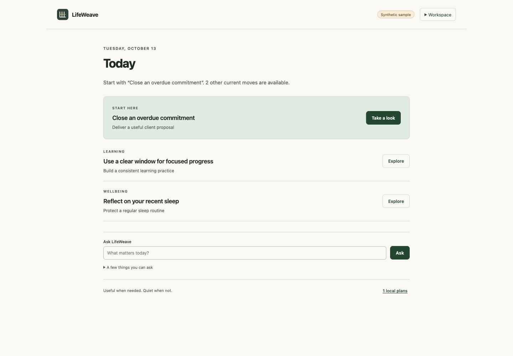

# LifeWeave

A local, proactive intelligent UI toolkit for the goals you choose.



LifeWeave connects goals to consented evidence and turns useful moments into working interfaces: a focus planner, an overdue-commitment review, a sleep reflection, a relationship reminder, or a measured-result check-in. It opens to a dashboard, with the evidence and controls needed for a next move. No prompt is required for the rule-driven baseline.

**Status: 0.1.0-alpha.4.** The local engine, console, portable packages, optional requested model views and macOS shell are implemented. Synthetic replay, policy tests, provider/model mocks, DOM/React tests and type checks validate software mechanisms. Live OAuth/account acceptance, general model quality, mobile delivery, multi-user enterprise operation and improved personal outcomes remain unverified or unimplemented. “World's best” is an ambition, not a measured result.

## A small daily board

Today shows at most three evidence-backed moves, with working tools opened only when useful. One request box chooses a concise brief, a progress table, a next-step comparison or a bounded focus scenario. Existing workspace tools remain available in a compact menu. Quiet hours and attention budgets still apply; hidden candidates do not spend attention. Read the [daily-board and response contract](docs/DAILY-BOARD.md).

## Shared context and outcomes

**Shared Context** connects active goals, eligible sources and explicit people/projects. Missing facts get a single reviewable question; user confirmations remain separate from original evidence. **Ask LifeWeave** builds a bounded focus view from a confirmed window without a model call. **Outcomes** separates drafts, user reports and later measurements, with comparable deltas and causal attribution unknown. Source revocation removes dependent records. See the [behavior and evaluation contract](docs/CONTEXT-AND-OUTCOMES.md).

## Run locally

Install Node.js 22 or later, then from this repository:

```sh
node scripts/start.mjs
```

Open `http://127.0.0.1:4317`. No model key, Docker, subscription, package installation or connected account is required for the sample or local goal workspace. The start script links the local workspace packages without downloading dependencies.

The sample contains **invented goals and evidence**. Choose **My personal workspace** for an empty local workspace, or **My business workspace** for separate local business objectives. Add a goal and chosen measurement, explicitly allow local evidence, then record a measurement. Suggestions respect quiet hours and the daily attention budget. Source revocation removes its observations and dependent drafts. Marking a suggestion handled never awards KPI progress.

The worker checks every 60 seconds while its host process is running. It does not run after that process exits. It produces local surfaces, not email notifications or external actions. State and consent records live under ignored `.private/runtime/` with restricted permissions. `LIFEWEAVE_DATA_DIR` selects another host-owned data directory and `LIFEWEAVE_PORT` changes the loopback port. Local state is plaintext; protect your device and backups. This is a single-user host, not a hardened multi-user server.

## Packages

| Package | Purpose |
| --- | --- |
| `@lifeweave/core` | Goals, typed observations, consent/freshness, proactive rules, declarative SurfaceFrames, bounded calculator expressions, feedback and attention receipts |
| `@lifeweave/ui` | Native DOM renderer, Web Component and optional React adapter, safe working scenario controls |
| `@lifeweave/connectors` | Read-only Graph reader, provider normalization, explicit health-export bridge and validated AG-UI-shaped event sink |
| `@lifeweave/planner` | Optional host-configured local/gateway model presentation proposals, grounded in current policy and always requiring review |

```js
import { createDemoState, evaluate } from '@lifeweave/core';
import { renderSurface } from '@lifeweave/ui';

const state = createDemoState();
const { surfaces } = evaluate(state, {
  now: state.fixture.clock,
  mode: 'replay', // Sample inspection only. Real workspaces use 'live'.
});
document.querySelector('main').append(renderSurface(surfaces[0]));
```

Import the UI stylesheet into your host. Use a bundler/package resolver or the console's import map. Packages are included in this source release; an npm registry publication is not claimed. `node scripts/package.mjs
node scripts/verify-packed.mjs
node scripts/verify-packed-negative.mjs` creates clean source and package archives with a manifest, using an explicit allowlist.

The dashboard stays quiet until useful evidence arrives. **Ask for a different view** opens a compact optional request control for the selected suggestion. It previews the result, requires you to review the wording, and checks current evidence again before you choose **Use this view**. Requested views are temporary; fresh state, another workspace or expiration restores the rule-driven original. No model is called by the worker.

To opt into an existing model service on your device:

```sh
LIFEWEAVE_MODEL=your-installed-model node scripts/start.mjs
```

The default endpoint is `http://127.0.0.1:11434/v1/chat/completions`. `LIFEWEAVE_MODEL_ENDPOINT` can choose another loopback HTTP chat-completions service; `LIFEWEAVE_MODEL_MAX_REQUESTS` sets a host-session allowance of 0–10, default one; `LIFEWEAVE_MODEL_TIMEOUT_MS` sets 1–60,000 ms, default 10,000. No model is downloaded or silently selected. A loopback endpoint can proxy a cloud service: configure its execution policy to keep inference local. Ollama documents [cloud-disable settings](https://docs.ollama.com/faq#how-do-i-disable-ollama-cloud-features). The console accepts no remote endpoint or key through the browser.

[The planner adapter](packages/planner/README.md) bounds requests, excludes raw source bodies and rejects changes to measurements, evidence or action authority. Proposals always require review because generated wording can still make unsupported claims. The default console has no configured model. Live transport canaries and broad model-quality evaluation are separate from mock acceptance.

## Desktop and mobile

The macOS AppKit/WebKit shell starts its own embedded loopback backend, owns its process lifetime, restricts navigation to its exact local origin, and uses no JavaScript-to-native command bridge. [Build instructions](apps/desktop/README.md) explain runtime notices and the signing/notarization gates. The current tested bundle is an ad-hoc local QA artifact, not a notarized installer.

The browser UI adapts to phones and includes an installable manifest. It still requires its local host to be reachable; it is not an implemented native iOS/Android app or offline account-sync service. Windows/Linux desktop binaries and native mobile companions are roadmap items.

## Open source and premium connections

All code in this repository is Apache-2.0. The personal/local engine, workspace, data export, renderer, and custom connector API remain open and useful without a subscription. Planned revenue comes from optional managed premium connections and enterprise offerings. No billing or paywall is implemented. See [commercial boundaries](docs/COMMERCIAL-MODEL.md).

Business capability packs can later add management telemetry, customer commitments, website creation, and marketing workflows. A local business workspace already uses separate state and tenant identifiers. Hosted teams still need membership, roles, source-sharing rules, encryption, retention, durable multi-worker scheduling and independent acceptance. Personal health data must not become team telemetry by default.

## Evidence and development

[Seven-repository source research](docs/research/upstream-analysis.md) compares CopilotKit, Thesys, Hermes, REA, Open Dots, OpenInstinct and Rakazo at pinned revisions with immutable source links. [Architecture](docs/ARCHITECTURE.md), [ADRs](docs/adr/README.md), [roadmap](docs/ROADMAP.md) and [verification](docs/evidence/verification.json) separate implemented mechanisms from future work. Private personal source material is excluded from this repository and every release archive.

```sh
node scripts/bootstrap.mjs
pnpm install --frozen-lockfile --ignore-scripts  # Development tools only.
node --test tests/*.test.mjs
pnpm exec tsc --project tsconfig.json
node scripts/replay.mjs
node scripts/verify.mjs
```

Tests use synthetic data and injected provider mocks. No upstream app, live account, paid model or desktop executor is invoked by the test suite. See [security boundaries](SECURITY.md) before adding a provider or exposing a host beyond loopback.
