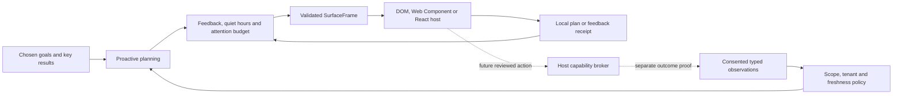

# LifeWeave architecture

The central object is an evidence-linked opportunity that renders as a working interface. A model is optional. Authorization, source validity and measurement truth remain outside the model.

`goal-system` owns explicit active/candidate/paused goals and user-defined metrics. `observations` owns data shape, explicit goal links and immutable ingestion. `proactive-planning` owns candidate generation, safe frame/expression validation, source expiry, feedback and delivery receipts. `action-policy` owns scopes, tenancy and connection checks. Public context entry points expose domain/application behavior; infrastructure remains host-owned.

The host console separates synthetic, personal and business state. Each state has a tenant identifier; cross-tenant evidence is rejected. The loopback host is intentionally single-user. Business state separation is not membership or multi-user ACL enforcement. Hosted organization membership, private/team visibility, per-source sharing and field-level sensitive-data policies are future requirements. Personal health, intimate communications and individual ambitions must never be exposed to managers by a workspace switch.

The local worker ticks every minute and evaluates current state without model calls. UI deliveries are recorded separately from worker evaluation. Daily receipt accounting and unchanged-evidence suppression reduce repeated interruptions. The desktop shell owns its backend; parent-death detection removes orphaned child processes. This is process-lifetime scheduling, not a registered login/background service or durable distributed job system.

SurfaceFrame accepts six declarative blocks: text, measurements, checklists, timelines, trends and calculator scenarios. Calculator expressions use a bounded arithmetic AST, never `eval` or host globals. A custom host renderer can override known schema types; extending the schema needs a reviewed version change. Arbitrary generated HTML/JSX is not enabled. Future sandboxed rich tools must be isolated from credentials, private raw observations and network authority.

The optional planner package sends only an explicitly selected eligible goal and scrubbed base surface to a host-configured local/gateway endpoint. It permits presentation changes while preserving numeric facts, evidence, timestamps, actions and calculator structure. Remote disclosure requires explicit host opt-in; attempt/time limits have no hidden retries. Interactive user requests can bypass display gates while source validity remains mandatory. Proposals always require review and never replace core state automatically. Mock transport tests prove these mechanisms, not live model quality or factual correctness of generated prose.

The read-only connector package normalizes Graph, Gmail and explicit health exports. Raw mail and events remain unconfirmed signals; only a host/user can provide commitment or free-slot fields. Live OAuth, token lifecycle, pagination, retries, rate limits and connect/read/revoke acceptance are outstanding. Generic AG-UI event emission is contract tested; CopilotKit and OpenUI runtime adapters are not yet integrated. Hermes/Rakazo are optional isolated runtimes, not transitive sources of permissions.

The application stores local JSON atomically with restrictive file permissions. It uses exact loopback host/origin checks, a local session cookie, CSRF checks, bounded JSON requests and an explicit static-asset allowlist with canonical-path checks. State is plaintext and the local API shares the host's OS trust boundary. Production encrypted storage, authentication, signed updates, crash recovery, telemetry policy and a durable multi-worker scheduler remain release gates.
